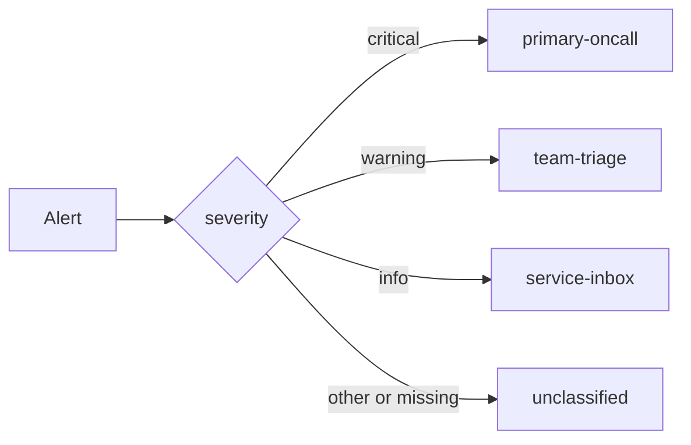

# Routing model

An alert enters Alertmanager's unconditional root route. Exact matches on the
`severity` label select one child receiver. The root receiver handles alerts
with missing or unrecognised severity labels.

## Receivers and grouping

`severity_destinations` maps the three supported severities to names in
`destinations`. Multiple severities can share a receiver.
`fallback_destination` must also name a declared receiver. Terraform validates
these references before exposing the Alertmanager output.

The emitted child routes use exact equality matchers and `continue = false`.
Label matching is case-sensitive, so `CRITICAL` and `critical-extra` take the
fallback route. Routing tests exercise these cases with Alertmanager's own
evaluator for both default and custom receiver maps.

The grouping keys are `alertname`, `service`, and `severity`. The initial group
wait is 30 seconds, the group interval is 5 minutes, and the repeat interval is
4 hours. Tune routing policy in `routing.tf` and rerun the routing tests when
changing these values. Missing labels still affect grouping, so check the
labels in the source alerts as well as the resulting receiver.

Each receiver uses a webhook URL file and sends resolved notifications.
`destinations` stores the absolute runtime path to each file. A runtime
notification service maps these webhooks to its delivery channels and incident
state. Keep endpoint contents in the runtime secret store.

## Escalation and rotation windows

`escalation_policies` maps receivers to ordered rotation steps. The first step
starts at zero minutes, followed by strictly increasing whole-minute offsets.
Offsets are elapsed time from the initial notification. The consumer resolves
the active responder at each escalation time and stops when the alert is
acknowledged or resolved.

A rotation defines a UTC anchor, fixed shift length, finite shift count, and a
cycle of distinct responder IDs. Shift starts are inclusive and ends are
exclusive. At a boundary, the incoming shift owns the instant. Fixed UTC
duration can move the local wall-clock handoff across daylight saving changes.

The finite windows make coverage limits visible. Extend coverage before it
expires, and define the consumer's handling of a coverage gap. Terraform exports
the policy and schedules for integration with that consumer.

## Context exports

The local Terraform plan exposes four related outputs.

| Output | Contents | Consumer |
| --- | --- | --- |
| `alertmanager_yaml` | Route tree and webhook receivers | Alertmanager configuration review |
| `oncall_schedules` | Finite responder windows by rotation | Notification consumer |
| `escalation_policies` | Ordered rotation steps by receiver | Notification consumer |
| `handoff_context` | Schedule map under `schedules` | Handoff report CLI |

Use the [on-call handbook](oncall-handbook.md) for a repeatable validation and
review workflow. The [Alertmanager configuration reference](https://prometheus.io/docs/alerting/latest/configuration/)
describes how Alertmanager processes the generated tree.
